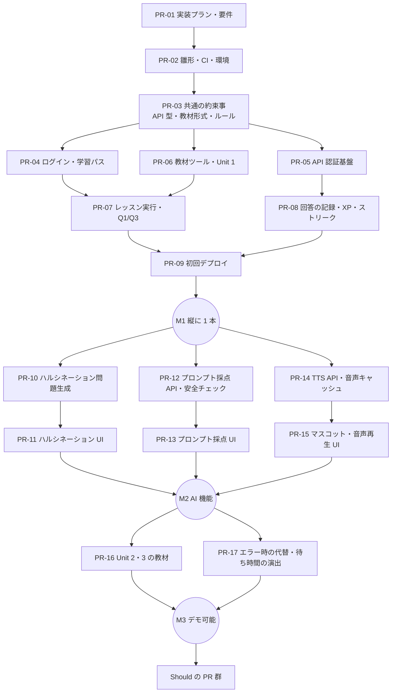

# 実装プラン：ailearn（仮称）

| 項目 | 内容 |
|------|------|
| 版 | 0.1 |
| 作成日 | 2026-11-09 |
| 元にする要件 | [docs/REQUIREMENTS.md](REQUIREMENTS.md)（以下「要件」） |
| 対象 | 要件の Must を全部、Should の一部 |

---

## 1. 進め方の方針

1. **開発はこのリポジトリで行い、小さな PR を順番に出す**。1 PR = 1 つの機能か 1 つの層。目安は 1 PR あたり差分 400 行以内（自動生成ファイルを除く）。
2. **最初に「共通の約束事」を決めて固める**（PR-03）。API の型、教材データの形式、Firestore のデータ構造を先に確定させ、フロントエンドとバックエンドを並行して作れるようにする。
3. **縦に 1 本通してから広げる**。最初のマイルストーンで「ログイン → 学習パス → 1 レッスンを遊ぶ → 本番 URL で動く」までを通し、その後に AI 機能を足していく。
4. **AI がなくてもデモが止まらない作りにする**。AI 呼び出しはすべて薄いラッパー越しに行い、テストではモックに差し替える。本番でも失敗したら事前生成したデータで代替する。
5. **提出用リポジトリへは、マイルストーンごとに最終版のファイルだけを反映する**（§9）。

## 2. リポジトリ構成（モノレポ）

```
.
├── app/                 # Flutter（Web 主、Android / iOS 副）
│   ├── lib/
│   │   ├── main.dart
│   │   ├── app/         # ルーティング、テーマ、DI（Riverpod の Provider 定義）
│   │   ├── core/        # API クライアント、認証、音声再生などのラッパー
│   │   ├── models/      # 共通の型（api/ の schema から生成 or 手書き）
│   │   └── features/    # 機能ごとのフォルダ
│   │       ├── auth/
│   │       ├── path/        # 学習パス画面
│   │       ├── lesson/      # レッスン実行と問題タイプごとの Widget
│   │       ├── progress/    # XP・ストリーク
│   │       └── teacher/     # 教員ダッシュボード（Should）
│   └── test/
├── api/                 # Cloud Run（Python / FastAPI）
│   ├── app/
│   │   ├── main.py
│   │   ├── auth.py          # ID トークン・App Check の検証
│   │   ├── schemas/         # Pydantic の型（API・教材・Firestore の正本。docs/CONTRACTS.md）
│   │   ├── routers/         # エンドポイント
│   │   ├── services/        # 採点・問題生成・TTS などの処理
│   │   ├── ai/              # Gemini / TTS / ADK の薄いラッパー
│   │   ├── safety/          # 個人情報チェック・出力チェック
│   │   └── repo/            # Firestore / Cloud Storage へのアクセス
│   ├── tests/
│   ├── pyproject.toml
│   └── Dockerfile
├── content/             # 教材データ（YAML）。ユニット・レッスン・問題
│   ├── schema/          # 教材データの JSON Schema（api/app/schemas/content.py から生成）
│   └── units/
├── tools/               # 教材の検証・Firestore への投入・問題の一括生成・音声の事前生成
├── firebase/
│   ├── firestore.rules
│   ├── firestore.indexes.json
│   ├── storage.rules
│   └── tests/           # セキュリティルールのテスト（Emulator）
├── docker/              # 開発用イメージ（Flutter、Firebase Emulator）
├── compose.yaml         # 開発環境（app / api / firebase）
├── Makefile             # よく使うコマンド（make up / make check など）
├── firebase.json
├── .firebaserc
├── .env.example
├── .github/workflows/   # CI
└── docs/
```

### 担当の排他（並列作業のときの境界）

| 領域 | ディレクトリ | 触ってよい PR |
|------|------------|--------------|
| フロントエンド | `app/` | フロントエンド系 PR |
| バックエンド | `api/` | バックエンド系 PR |
| 教材 | `content/`、`tools/` | 教材系 PR |
| インフラ | `firebase/`、`firebase.json`、`.github/`、`docker/`、`compose.yaml`、`Makefile`、`api/Dockerfile` | インフラ系 PR |
| 共通の約束事 | `api/app/schemas/`、`firebase/*.rules`（生成物: `docs/openapi.json`、`docs/schemas/`、`content/schema/`） | PR-03 と、それを変更する専用の PR のみ |

共通の約束事を変えたくなったら、機能 PR の中で変えずに、先に約束事だけの PR を出す。

## 3. 技術的な決めごと

| 項目 | 決めごと | 理由 |
|------|---------|------|
| リージョン | Cloud Run・Firestore・Cloud Storage は `asia-northeast1`（東京） | 国内の学校からの遅延が小さい |
| Gemini のリージョン | Vertex AI のエンドポイントは、使うモデルが提供されているリージョン（または global）を実装時に確認して設定値にする | モデルによって提供リージョンが違うため。コードに直書きしない |
| モデル ID | 環境変数で指定（例: `GEMINI_MODEL_FAST`、`GEMINI_MODEL_QUALITY`、`GEMINI_MODEL_TTS`） | モデルの入れ替えをコード変更なしで行える |
| 認証情報 | Cloud Run はサービスアカウント、ローカルは `gcloud auth application-default login` | API キーをどこにも置かない |
| API の型の正本 | `api/app/schemas/`（Pydantic）。FastAPI が出す OpenAPI を `docs/openapi.json` に書き出してコミットし、Flutter 側の型はこれに合わせる | 型の定義を 1 か所にする |
| 教材の正本 | 形式は `api/app/schemas/content.py`、中身は `content/` の YAML。`tools/` のスクリプトで検証してから Firestore へ投入 | 教材をコードレビューと同じ流れで確認できる |
| 正解キー | `content/` の中でも別ファイル（`*.answers.yaml`）に分け、Firestore の `answerKeys` にだけ投入 | クライアントに渡らないことを構造で保証する |
| 状態管理 | Riverpod。画面の外の状態は Provider に集約 | 共有状態を一か所にまとめる |
| ローカル開発 | Docker Compose で Flutter Web・FastAPI・Firebase Emulator Suite（Auth / Firestore / Storage）を起動。ツールのバージョンは Dockerfile で固定 | 全員が同じバージョンで動かせる。本番を汚さず、課金も抑える |
| CI | このリポジトリの GitHub Actions で、ローカルと同じコンテナを使って `make check-api`・`make check-app`・Web と Cloud Run イメージのビルド・Emulator の起動を実行 | push 前チェックの「整合性」を自動化する。ローカルと CI の差をなくす |
| デプロイ | 初期は手動（`firebase deploy`、`gcloud run deploy`）。余裕があれば main への merge で自動デプロイ | まず動くものを早く出す |

### 主な依存ライブラリ（バージョンは実装時点の最新安定版）

| 領域 | ライブラリ |
|------|-----------|
| Flutter | `firebase_core`、`firebase_auth`、`cloud_firestore`、`firebase_app_check`、`firebase_storage`、`flutter_riverpod`、`go_router`、`http`、音声再生（`just_audio` など Web 対応のもの） |
| Python | `fastapi`、`uvicorn`、`pydantic`、`google-genai`、`google-adk`、`firebase-admin`、`google-cloud-storage`、`pytest`、`ruff` |
| ルールのテスト | `@firebase/rules-unit-testing`（Node） |

依存を追加する PR（PR-02 と、ADK を入れる PR）では、追加する前に security-check で既知の深刻な脆弱性・なりすましパッケージがないかを軽く確認する。

## 4. PR ロードマップ

### 4.1 全体像



### 4.2 PR 一覧

「並列」の欄が同じ記号の PR は、担当ディレクトリが重ならないので同時に進めてよい。

#### マイルストーン M0：土台

| PR | ブランチ | 内容 | 主な領域 | 完了条件 | 並列 |
|----|---------|------|---------|---------|------|
| PR-01 | `feature/implementation-plan` | 要件定義書のコピー、この実装プラン、`docs/PRODUCT.md` の記入（開発原則を含む） | `docs/` | レビューで合意 | — |
| PR-02 | `feature/project-scaffolding` | Flutter・FastAPI・Firebase の雛形、`.env.example`、`.gitignore` の追記、CI、README のセットアップ手順 | 全体 | CI が通る。Emulator とローカル API が起動し、Flutter Web から API のヘルスチェックを呼べる | — |
| PR-03 | `feature/shared-contracts` | API のリクエスト / レスポンス型と `docs/openapi.json`、教材の JSON Schema、Firestore のセキュリティルールとそのテスト、エラー形式の統一（未実装のエンドポイントは 501） | 共通の約束事 | ルールのテストで「`answerKeys` はクライアントから読めない」「XP は本人が書き換えられない」が確認できる | — |

#### マイルストーン M1：縦に 1 本通す（Unit 1 が本番 URL で遊べる）

| PR | ブランチ | 内容 | 主な領域 | 完了条件 | 並列 |
|----|---------|------|---------|---------|------|
| PR-04 | `feature/auth-and-path` | Google ログイン・匿名ログイン、学習パス画面（Firestore から読む） | `app/` | Emulator 上でログインし、ユニットとレッスンの一覧が表示される | A |
| PR-05 | `feature/api-auth` | ID トークンと App Check の検証、構造化ログ | `api/` | 不正なトークンで 401 になるテスト | A |
| PR-06 | `feature/content-tools` | 教材 YAML の検証スクリプト、Firestore への投入スクリプト、Unit 1 の教材（Q1・Q3） | `content/`、`tools/` | 検証が通り、Emulator に投入できる | A |
| PR-07 | `feature/lesson-player` | レッスン実行画面、Q1（選択・正誤）・Q3（並べ替え・穴埋め）の Widget、結果画面 | `app/` | Unit 1 のレッスンを最後まで遊べる（Widget テスト付き） | B |
| PR-08 | `feature/progress-api` | `/v1/answers`（Q1・Q2・Q3。Q2の確定的採点をPR-10から前倒し）と `/v1/lessons/{lessonId}/complete`、回答の記録、XP・ストリークの計算（サーバー側のみで更新） | `api/` | ストリークの境界（日付またぎ、お休みチケット）のテスト、Firestore Emulatorでの回答・完了・同時実行テスト | B |
| PR-09 | `feature/first-deploy` | Firebase Hosting・Cloud Run へのデプロイ手順と設定（`make deploy`、docs/DEPLOY.md）、アプリの App Check（reCAPTCHA Enterprise）、本番への教材投入（`seed-production`）、README に URL | インフラ・`app/`・`tools/` | 本番 URL で Unit 1 が遊べる | — |

#### マイルストーン M2：AI 機能

| PR | ブランチ | 内容 | 主な領域 | 完了条件 | 並列 |
|----|---------|------|---------|---------|------|
| PR-10 | `feature/hallucination-api` | 誤り注入による問題の一括生成ツール（下書きとして保存し、人がレビューしてから公開） | `api/`、`tools/` | 生成した問題の JSON がスキーマを満たす（Q2採点はPR-08で実装） | C |
| PR-12 | `feature/prompt-evaluate-api` | `/v1/prompt/evaluate`、ルーブリックと採点例、入力の個人情報チェック、出力のスキーマ検証 | `api/`（`safety/` を含む） | Gemini をモックした採点テスト、個人情報検出のテスト。実モデルでの採点ぶれを数件で確認した記録 | C※ |
| PR-14 | `feature/tts-api` | `/v1/tts`（回答のフィードバック文のみ音声化）、Cloud Storage へのキャッシュ、Cloud Text-to-Speech への切り替え、固定セリフの事前生成ツール | `api/`、`tools/` | 同じ文章の 2 回目がキャッシュから返るテスト | C※ |
| PR-11 | `feature/hallucination-ui` | Q2：文をタップして提出、結果と解説の表示 | `app/` | Widget テスト、実 API での動作確認 | D |
| PR-13 | `feature/prompt-evaluate-ui` | Q4：プロンプト入力、送信前の個人情報警告、観点別スコアの表示 | `app/` | Widget テスト、実 API での動作確認 | D※ |
| PR-15 | `feature/mascot-voice` | マスコットの表示枠（仮の絵）、音声の再生・停止、字幕、音声 OFF 設定 | `app/` | 音声 OFF でもレッスンが進むことを確認 | D※ |

※ 同じ `api/` や `app/` の中で並列にする場合は、`routers/` `services/` のファイルを PR ごとに分け、共通ファイル（`main.py` へのルーター登録、`app/` のルーティング定義）の変更は 1 行の追加にとどめる。衝突しそうなら直列にする。

#### マイルストーン M3：デモ可能

| PR | ブランチ | 内容 | 主な領域 | 完了条件 |
|----|---------|------|---------|---------|
| PR-16 | `feature/content-unit2-3` | Unit 2・3 の教材、生成したハルシネーション問題のレビューと公開、固定セリフの音声の事前生成 | `content/`、`tools/` | Unit 1〜3 を通しで遊べる |
| PR-17 | `feature/resilience-and-polish` | AI がタイムアウトしたときの代替問題・定型フィードバック、待ち時間のアニメーション、デモ用アカウントとデータ | `app/`、`api/` | 要件 §12.2 のデモシナリオを 3 回連続で通せる |

#### マイルストーン M4：Should（余裕に応じて上から）

| PR | 内容 | 要件の機能 ID |
|----|------|--------------|
| PR-18 | エージェント組み立て（ADK、模擬ツール、ステップ表示） | F-12 |
| PR-19 | ファクトチェック演習（Grounding with Google Search） | F-11 |
| PR-20 | クラス機能と教員ダッシュボード | F-13、F-14 |
| PR-21 | 復習キュー | F-10 |
| PR-22 | ビフォー・アフター比較（`/v1/prompt/run`） | F-15 |

エージェント組み立て（PR-18）はプロダクトの差別化要素なので、M4 の中では最優先にする。時間が足りないときは、1 つのお題だけ動く形でもデモに入れる。

## 5. 実行方式（規模判定）

- 全体の規模は**大**（フロントエンド・バックエンド・教材・インフラに分かれる）。
- ただし **PR-01〜03 は直列**で進める。共通の約束事を固める前に並列にすると、型の食い違いが起きるため。
- PR-03 の merge 後は、§4.2 の「並列」欄に従って、領域が重ならない PR を同時に進めてよい。
  - 1 人の Claude Code セッションで並列にする場合は、各エージェントに `isolation: "worktree"` を指定し、PR ごとのブランチで作業させる。
  - 並列作業の状態共有には、ホワイトボード `.company/engineering/whiteboard/ailearn-<日付>.md` を使う（担当表・確定したインターフェース・決定事項・未解決の懸念を書く）。このファイルはセッション内の作業用なので git 管理外にする（PR-02 で `.gitignore` に `.company/` を追加）。
  - 複数のメンバーで分担する場合は、各 PR の担当者を GitHub の Issue か PR の Draft で宣言してから着手する。
- 迷ったら直列にする。

## 6. テスト方針

| 対象 | 方法 | CI |
|------|------|----|
| Flutter の画面・問題 Widget | Widget テスト（`flutter test`）。API クライアントはモックに差し替え | ○ |
| API のエンドポイント | `pytest` + FastAPI の TestClient。Gemini・TTS・Firestore はラッパーごとモックに差し替え | ○ |
| 採点・ストリークなどのロジック | `pytest` の単体テスト。境界値（0 点・満点、日付またぎ）を必ず入れる | ○ |
| Firestore のセキュリティルール | Emulator + `@firebase/rules-unit-testing` | ○ |
| 教材データ | `tools/` の検証スクリプト（JSON Schema、ID の重複、正解キーとの対応） | ○ |
| AI の出力品質 | 実モデルで少数のケースを手動実行し、結果を PR に記録（CI では実モデルを呼ばない） | × |
| 通しの動作 | 本番 URL でデモシナリオを手動実行し、スクリーンショットか録画を PR に添付 | × |

## 7. 各 PR の完了の定義

チームの push 前チェック（`CLAUDE.md` の §3）に加えて、次を満たすこと。

- [ ] CI がすべて通っている
- [ ] 追加した機能のテストがある。テストを書けないもの（AI の出力品質など）は、確認した結果を PR 本文に書いている
- [ ] 外から値が入る場所（API の受け口、教材の読み込み、ユーザー入力）で検証している
- [ ] 新しい環境変数を `.env.example` に追記している
- [ ] 要件とずれた点があれば、`docs/REQUIREMENTS.md` も同じ PR で更新している
- [ ] セットアップ手順やコマンドが変わったら `docs/PRODUCT.md` と README を更新している

## 8. 着手前に人がやること

Claude だけでは進められない作業。PR-02 の前（遅くとも PR-09 の前）に必要。

| # | 作業 | 必要になる PR |
|---|------|-------------|
| 1 | Google Cloud プロジェクトと Firebase プロジェクトを作成し、課金アカウントを紐付ける | PR-02（Emulator だけなら PR-09 まで不要） |
| 2 | 予算アラートを設定する（例：月 5,000 円で通知） | PR-10 より前 |
| 3 | Vertex AI・Cloud Run・Cloud Storage・Text-to-Speech・App Check（reCAPTCHA Enterprise）の API を有効にする | PR-05、PR-09、PR-10 |
| 4 | `gcloud auth login`・`gcloud auth application-default login`・`firebase login` をローカルで実行する | PR-02 |
| 5 | 未成年向けサービスでの Gemini / Google Cloud の利用規約を確認する（要件 §14 R1） | PR-10 より前 |
| 6 | ハッカソンの締切・提出物の形式を確認し、このプランの日程に当てはめる | PR-02 |

## 9. 提出用リポジトリへの反映

- マイルストーン（M1・M2・M3・最終版）ごとに、このリポジトリの main の**ファイルだけ**を提出用リポジトリへコピーして PR を出す。履歴は持ち込まない（過去のコミットに秘密情報が紛れていても公開されないようにするため）。
- コピー対象から外すもの：`.claude/`、`CLAUDE.md`、`CLAUDE.local.md`、`CLAUDE.local.md.example`、`.mcp.json`、`.company/`、`.env`（提出用リポジトリの `.gitignore` でも除外済み）。
- 反映方法の例：`git archive` で main を書き出し、除外対象を除いて提出用リポジトリの作業ツリーへ展開する。反映の前に、秘密情報が含まれていないかを確認する。
- 提出用リポジトリの README には、デプロイした URL・使い方・技術構成を書く。

## 10. 日程の目安

ハッカソンの期間が決まったら、この表を実際の日付に置き換える。

| マイルストーン | 含む PR | 目安 |
|--------------|---------|------|
| M0 土台 | PR-01〜03 | Day 0 |
| M1 縦に 1 本 | PR-04〜09 | Day 1 |
| M2 AI 機能 | PR-10〜15 | Day 2〜3 |
| M3 デモ可能 | PR-16〜17 | Day 4 |
| M4 Should | PR-18〜 | 残りの時間 |
| 提出 | 提出用リポジトリへの最終反映 | 締切の前日 |
