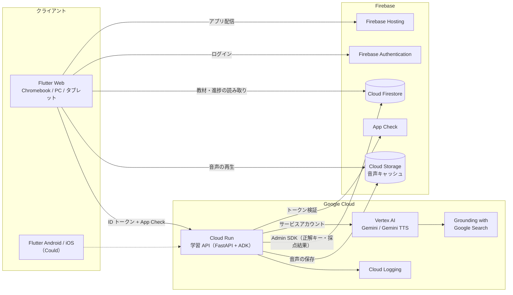
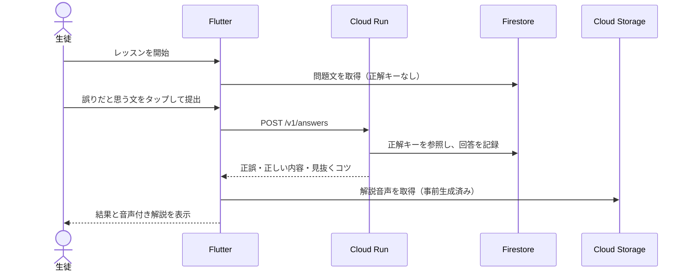
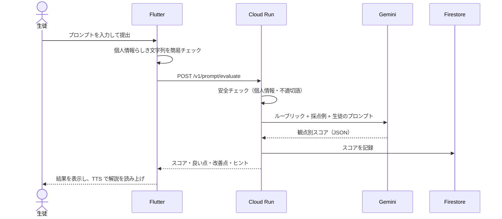

# 要件定義書：ailearn（仮称）— 中高生向け AI リテラシー学習アプリ

| 項目 | 内容 |
|------|------|
| プロダクト名 | ailearn（仮称） |
| 版 | 0.2（ドラフト） |
| 作成日 | 2026-11-09 |
| ステータス | チームレビュー待ち |
| 未決事項 | [§15](#15-未決事項) を参照 |

---

## 1. 背景と課題

- 中高生の生成 AI 利用は急速に広がっているが、**AI の回答を鵜呑みにする**、**個人情報をそのまま入力する**といった使い方が多く、正しい付き合い方を学ぶ機会が少ない。
- 文部科学省も初等中等教育段階での生成 AI 活用ガイドラインを出しているが、現場では「何をどう教えるか」の教材と、教員の準備時間が不足している。
- 一方で社会は「AI に質問する」段階から「**AI エージェントに仕事を任せ、レビューする**」段階へ移りつつあり、作り手としてのリテラシーも求められている。

### 解決したい課題

| # | 課題 | 本プロダクトでの解決 |
|---|------|------------------|
| P1 | AI の誤り（ハルシネーション）に気づけない | 誤りが含まれた AI 回答から誤りを探す演習を繰り返す |
| P2 | 良いプロンプトの書き方を体系的に学べない | 生徒が書いたプロンプトを AI がルーブリックで採点し、改善点を返す |
| P3 | 学習が続かない | Duolingo 型の短いレッスン・XP・ストリーク・マスコットで習慣化する |
| P4 | エージェント時代の「作る力」を学ぶ入口がない | エージェントを組み立て、最終的にミニアプリを作らせてレビューする体験を用意する |
| P5 | 教員が生徒の理解度を把握しにくい | クラス単位の進捗・つまずき箇所を見られる教員ダッシュボード |

## 2. プロダクトビジョン

> **AI を「使われる側」から「使いこなし、作る側」へ。1 日 5 分、ゲーム感覚で。**

### コアバリュー

1. **本物の AI で練習する**：教科書の読み物ではなく、実際に Gemini とやり取りしながら学ぶ。
2. **間違いを見抜く目を育てる**：誤りをあらかじめ仕込んだ問題で、確実に採点できるハルシネーション演習を行う。
3. **続けられる**：1 レッスン 3〜5 分、音声付きのマスコットが案内する。

### 類似サービスとの違い（仮説、要調査）

| 観点 | 一般的な AI リテラシー教材 | 本プロダクト |
|------|--------------------------|-------------|
| 形式 | 動画・スライド・読み物 | 短いインタラクティブ演習 |
| AI との実対話 | なし、または自由チャットのみ | 目的別の演習の中で安全に対話 |
| 採点 | 選択問題中心 | 誤り注入による確実な採点 + AI によるルーブリック採点 |
| ゴール | 「注意して使おう」 | エージェントを使ってプロダクトを作るところまで |

## 3. ターゲットユーザー

| 区分 | 対象 | ニーズ |
|------|------|--------|
| 主ユーザー | 中学 1 年〜高校 3 年（12〜18 歳） | 楽しく短時間で、AI を上手に使えるようになりたい |
| 副ユーザー | 中学・高校の教員（主に情報科） | 授業で使える教材と、クラスの理解度の把握 |
| 将来 | 学校管理者・自治体 | 導入状況・学習効果の把握（今回は対象外） |

### ペルソナ

- **生徒 A（中学 2 年）**：宿題で AI を使ったことはあるが、出てきた答えをそのまま写している。スマホゲームは毎日やる。
- **生徒 B（高校 2 年・情報 I 履修中）**：プログラミングに興味があり、AI でアプリを作ってみたいが何から始めればよいか分からない。
- **教員 C（情報科）**：生成 AI の授業を任されたが、教材作りの時間がない。生徒が個人情報を入力しないか心配している。

## 4. 学習設計

### 4.1 到達レベル

| レベル | 名称 | できるようになること |
|--------|------|--------------------|
| Lv1 | AI を知る | 生成 AI の仕組みをざっくり説明でき、得意・不得意が分かる |
| Lv2 | AI を疑う | AI の回答から誤りを見つけ、出典で確かめられる |
| Lv3 | AI を使いこなす | 目的・前提・条件・出力形式を含んだプロンプトを書き、改善できる |
| Lv4 | AI と作る | エージェントに仕事を分担させ、成果物を人間としてレビューできる |

### 4.2 カリキュラム（ユニット構成案）

| Unit | タイトル | 主な内容 | レベル | MVP |
|------|---------|---------|--------|-----|
| 1 | AI ってなに？ | 次の単語を予測する仕組み、得意・不得意、AI は「知っている」わけではない | Lv1 | ○ |
| 2 | プロンプトの基本 | 役割・目的・前提・条件・出力形式の 5 要素 | Lv3 | ○ |
| 3 | ハルシネーションを見抜く | 数値・日付・人名・存在しない出典・それっぽい因果関係の見抜き方、ファクトチェック | Lv2 | ○ |
| 4 | プロンプトを磨く | 例を示す（Few-shot）、段階的に考えさせる、繰り返し改善する | Lv3 | △ |
| 5 | AI と安全・ルール | 個人情報、著作権、偏り（バイアス）、ディープフェイク、学校でのルール | Lv1〜2 | △ |
| 6 | AI エージェントのしくみ | 目標・計画・ツール・観察のループ、人間の確認が必要な場面 | Lv4 | △ |
| 7 | エージェントでプロダクトを作ろう | 要件 → 設計 → 実装 → レビューをエージェントに分担させ、成果物を確かめる | Lv4 | × |

○: MVP で実装 / △: 1〜2 レッスンのみ実装 / ×: ストレッチゴール

### 4.3 レッスンの構成

- 1 レッスン = 5〜8 問、所要 3〜5 分。
- 流れ：**マスコットの導入（音声）→ 演習 → 即時フィードバック（音声付き解説）→ 結果画面（XP 獲得）**。
- 間違えた問題は「復習キュー」に入り、後のレッスンで再出題する（間隔反復）。

### 4.4 問題タイプ

| ID | 問題タイプ | 内容 | 採点方法 | AI の使い方 |
|----|-----------|------|---------|------------|
| Q1 | 選択・正誤問題 | 知識の確認 | 固定の正解 | なし（教材は事前生成） |
| Q2 | ハルシネーション探し | AI 回答の中から誤った文をタップする | 誤り注入時の正解キーと照合（確定的） | 事前生成（§5.2） |
| Q3 | プロンプト並べ替え・穴埋め | 良いプロンプトの部品を組み立てる | 固定の正解 | なし |
| Q4 | プロンプト作成 | お題に対してプロンプトを自由に書く | Gemini がルーブリックで採点 | リアルタイム（§5.3） |
| Q5 | ビフォー・アフター比較 | 悪いプロンプトと自分のプロンプトの実行結果を並べて比べる | 自己評価 + AI コメント | リアルタイム |
| Q6 | ファクトチェック | AI の主張を Google 検索の出典と突き合わせる | 出典付きで正誤を判定 | Grounding with Google Search |
| Q7 | エージェント組み立て | 目標・ツール・手順をブロックで組み、実行の様子を観察する | 目標達成の可否 | ADK でエージェントを実行（§5.5） |
| Q8 | リスニング | 音声で読み上げた AI 回答から誤りを聞き取る | 固定の正解 | Gemini TTS |
| Q9 | 紙芝居シナリオ（`story`） | 絵・セリフ・キャラクターの声で進むお話の途中で主人公の行動を選び、選んだ行動の結末を見る | 固定の正解（最善の行動）。結末は選択ごとに用意 | 絵は Gemini の画像モデル、声は Gemini-TTS で事前生成 |
| Q10 | ライブ・ハルシネーション検証（`live_check`） | 自分で書いたプロンプトに AI が答え、こっそり入れられた誤りを、Google 検索の出典を調べながら見つける | サーバーがその場で入れた誤りと照合（確定的） | リアルタイム（Grounding with Google Search + 誤り注入）。1 日の回数制限あり |
| Q11 | エージェント組み立て（`agent`） | 目標に合わせてツールとルールのブロックを選び、AI エージェントが動く様子（考える → ツール → 結果）を見る | 必須・禁止のブロックとの照合（確定的） | ADK でエージェントを実行（模擬ツールのみ）。実行の様子の文章は Gemini |

### 4.5 ゲーミフィケーション

| 要素 | 内容 | 配慮 |
|------|------|------|
| XP | レッスン完了・正解で獲得 | — |
| ストリーク | 連続学習日数 | 土日・長期休暇は「お休みチケット」で途切れない |
| ハート（ライフ） | 間違えると減り、0 で一時休憩 | 授業モードでは無効にできる |
| クラスリーグ | クラス内の週間 XP ランキング | 教員が ON/OFF を設定。順位は上位のみ表示し、下位を晒さない |
| バッジ | 「ハルシネーションハンター」など | — |
| マスコット | 解説・応援を音声で話すキャラクター | 名前・デザインは要検討（§15）。オリジナルキャラクターを作る（既存キャラは使わない） |

## 5. 機能要件

### 5.1 機能一覧（優先度：MoSCoW）

| ID | 機能 | 優先度 | 概要 |
|----|------|--------|------|
| F-01 | ログイン | Must | Google アカウントでログイン。デモ用に匿名ログインも用意 |
| F-02 | 学習パス画面 | Must | ユニット・レッスンを道のように並べ、進捗を表示 |
| F-03 | レッスン実行 | Must | Q1〜Q4 の問題タイプを出題・採点 |
| F-04 | ハルシネーション探し | Must | 誤り注入方式の問題（§5.2） |
| F-05 | プロンプト採点 | Must | ルーブリック採点とフィードバック（§5.3） |
| F-06 | 音声読み上げ | Must | マスコットの導入・解説を Gemini TTS で読み上げ（§5.4） |
| F-07 | XP・ストリーク | Must | 獲得と表示 |
| F-08 | 学習履歴の保存 | Must | 回答・スコアを Firestore に保存 |
| F-09 | 入力の安全チェック | Must | 個人情報らしき入力を検出して送信前に警告（§11） |
| F-10 | 復習キュー | Should | 間違えた問題を再出題 |
| F-11 | ファクトチェック演習 | Should | Grounding with Google Search で出典を提示（Q6） |
| F-12 | エージェント組み立て | Should | ブロックでエージェントを組んで実行（§5.5） |
| F-13 | クラス機能 | Should | 教員がクラスを作り、招待コードで生徒が参加 |
| F-14 | 教員ダッシュボード | Should | クラスの進捗、問題ごとの正答率、プロンプトスコアの推移 |
| F-15 | ビフォー・アフター比較 | Should | Q5 |
| F-16 | 最終プロジェクト | Could | エージェントにミニアプリを作らせてレビュー（§5.6） |
| F-17 | マスコットと音声会話 | Could | Gemini Live API で質問に音声で答える |
| F-18 | Google Classroom 連携 | Could | レッスンを課題として配信、名簿を取り込み |
| F-19 | モバイルアプリ配布 | Could | 同じ Flutter コードで Android / iOS ビルド |
| F-20 | 課金・保護者アプリ・多言語 | Won't | 今回は対象外 |

### 5.2 ハルシネーション探し（F-04）

**方針：AI に「誤りの判定」をさせず、「誤りの注入」をさせる。** 正解キーが生成時点で確定するため、採点がぶれない。

1. **正しい文章の生成**：Gemini に、中高生向けのテーマ（歴史・理科・地理など）の短い解説文を Grounding with Google Search 付きで生成させる。
2. **誤りの注入**：別のプロンプトで、文章のうち 1〜3 文に種類を指定して誤りを入れさせる。出力は JSON スキーマで固定する。
   - 誤りの種類：数値、日付、人名・地名、存在しない出典、誤った因果関係
3. **人によるレビュー**：チームが内容を確認し、問題なければ公開する（MVP では事前生成した問題のみ出題）。
4. **出題と採点**：クライアントには文章だけを渡し、正解キーはサーバー側にだけ置く。生徒が誤りだと思う文をタップして提出すると、サーバーが照合し、正誤・正しい内容・見抜くコツを返す。

```json
{
  "topic": "光合成",
  "sentences": [
    { "index": 0, "text": "光合成は植物が光のエネルギーを使って栄養をつくるしくみです。" },
    { "index": 1, "text": "光合成は主に根の細胞で行われます。" }
  ],
  "answerKey": [
    {
      "index": 1,
      "errorType": "fact",
      "correction": "光合成は主に葉の葉緑体で行われます。",
      "tip": "「どこで」を教科書で確かめてみよう。"
    }
  ]
}
```

`answerKey` は Firestore 上でクライアントから読めない場所に保存する（§9）。

### 5.3 プロンプト採点（F-05）

- お題の例：「来週の文化祭のクラス出し物のアイデアを AI に出してもらうプロンプトを書こう」
- 採点ルーブリック（各 0〜2 点、合計 10 点）：

| 観点 | 2 点の基準 |
|------|-----------|
| 目的 | 何のために、何をしてほしいかが明確 |
| 前提・文脈 | 対象・状況・使える条件が書かれている |
| 条件・制約 | 数・長さ・してほしくないことが指定されている |
| 出力形式 | 箇条書き・表など、受け取りたい形が指定されている |
| 安全性 | 個人情報や不適切な内容を含んでいない |

- 処理：Gemini に、ルーブリックと採点例（Few-shot）を与え、`temperature` を低くして JSON で採点させる。
- 返すもの：観点別スコア、良い点 1 つ、改善点 1〜2 つ、ヒント（模範解答そのものは見せず、考える余地を残す）。
- スコアが 6 点以上なら、実際にそのプロンプトを Gemini で実行して結果を見せる（Q5 に接続）。

### 5.4 音声読み上げ（F-06）

- マスコットのセリフ・解説文を **Gemini TTS** で音声化する。話し方（明るく、ゆっくりなど）は自然言語のスタイル指定で調整する。
- 同じ文章は毎回生成しない。`文章 + 声 + スタイル` のハッシュをキーに Cloud Storage へキャッシュし、2 回目以降はキャッシュを返す。
- 教材の固定セリフはビルド時に事前生成する。リアルタイム生成は AI のフィードバック文だけにする。
- 字幕を常に表示し、音声 OFF でも学習できるようにする（教室での利用を考慮）。
- Gemini TTS が使えない場合は Cloud Text-to-Speech に切り替える。

### 5.5 エージェント組み立て（F-12）

- 生徒は次の 3 種類のブロックを組み合わせて「エージェント」を作る。
  - **目標**：例「明日の遠足の持ち物リストを作る」
  - **ツール**：天気を調べる、メモに書く、計算する など（すべて学習用の模擬ツール）
  - **ルール**：例「分からないときは人間に聞く」
- サーバー側で Agent Development Kit（ADK）のエージェントとして実行し、**考える → ツールを使う → 結果を見る** の各ステップを画面に順番に表示する。
- ツールが足りない・ルールがないと失敗するお題を用意し、「なぜ失敗したか」を考えさせる。
- 仕組み（契約: 問題の種類 `agent`）:
  - 問題: 目標 `goal`、状況 `situation`、選べるツール `tools` とルール `rules`、持たせられるツールの数の上限 `maxTools`（全部持たせる作戦を防ぐ）。
  - 回答: 選んだツールとルールを `/v1/answers` に送る（`{"type":"agent","toolIds","ruleIds"}`）。
  - 採点は確定的：正解キーの必須ツール・必須ルールをすべて選び、禁止ツールを選んでいなければ成功。
  - サーバーは選ばれたブロックだけを持つ ADK のエージェントを実行し、模擬ツールは正解キーの決まった出力 `toolOutputs` を返す。実行の様子は `steps`（考える / ツールを使う / 結果を見る / 人に聞く / 答える / あきらめる）として結果に入る。足りないツール・ルール、選んではいけないツールも結果で示す。

### 5.6 最終プロジェクト：エージェントでプロダクトを作る（F-16、ストレッチ）

1. 生徒が作りたいミニアプリの要件を書く（例：「クラスの席替えアプリ」）。Unit 2〜4 のプロンプトの知識を使う。
2. ADK のマルチエージェント（企画 → 設計 → 実装 → レビュー）が、単一 HTML ファイルのミニアプリを作る。
3. 成果物をサンドボックス化した iframe（外部通信なし）で実行し、生徒が動作を確認する。
4. 生徒は「要件どおりか」「バグはないか」をチェックリストで確認し、修正指示を出す。
5. 学びのポイント：**AI に任せた部分ほど、人間の確認が必要**であることを体験する。

## 6. 非機能要件

| 区分 | 要件 |
|------|------|
| 対応環境 | Chromebook・Windows の Chrome（最優先）、iPad の Safari、Android の Chrome |
| 性能 | 画面遷移 1 秒以内。AI の採点は 5 秒以内を目標とし、待ち時間はマスコットのアニメーションで演出 |
| 可用性 | ハッカソンのデモ期間中に動くこと。AI が失敗した場合は事前生成済みの問題にフォールバック |
| 同時利用 | 1 クラス（40 人）の同時利用に耐える |
| セキュリティ | 全 API で Firebase ID トークンと App Check トークンを検証。正解キーはクライアントに渡さない |
| 秘密情報 | API キーをリポジトリに置かない。Cloud Run からはサービスアカウント経由で Vertex AI を呼ぶ |
| プライバシー | 収集する個人情報は最小限（表示名・学年・クラス）。本名・メールは教員以外に表示しない |
| 安全性 | §11 の AI 安全設計に従う |
| アクセシビリティ | 字幕、文字サイズ変更、色だけに頼らない正誤表示、中学 1 年が読める語彙（難しい漢字にはふりがなを検討） |
| コスト | 1 生徒あたりの AI 呼び出し回数に上限を設定。事前生成とキャッシュを優先 |

## 7. 技術スタック

Google の技術を中心に構成する。

**選定方針**：チーム全員が AI コーディングエージェントで開発するため、メンバーの習熟度や学習コストは選定基準にしない。各技術は、**プロダクトにとって有利か**（学習体験の質、未成年向けの安全性、Google 技術どうしの統合のしやすさ、運用・コスト、デモでの見せやすさ）で選ぶ。

| レイヤ | 技術 | 用途・採用理由 |
|--------|------|---------------|
| フロントエンド | **Flutter**（Dart） | Web（Chromebook）を主、Android / iOS を副として 1 つのコードで対応。アニメーションの多いゲーム風 UI に向く |
| 状態管理・画面遷移 | Riverpod、go_router | Flutter で定番の構成 |
| ホスティング | **Firebase Hosting** | Flutter Web の配信。CDN と SSL が付属し、CLI 1 コマンドでデプロイできる |
| 認証 | **Firebase Authentication** | Google ログイン（学校の Google Workspace アカウントと相性が良い）、匿名ログイン |
| データベース | **Cloud Firestore** | 教材・進捗・クラス。リアルタイム更新で教員ダッシュボードにも使える |
| ファイル | **Cloud Storage for Firebase** | TTS 音声のキャッシュ、マスコット画像 |
| 不正利用対策 | **Firebase App Check** | 自分たちのアプリ以外から API を呼ばれるのを防ぐ |
| バックエンド | **Cloud Run**（Python / FastAPI） | 採点・問題生成・TTS・エージェント実行の API。ADK が最も成熟している Python を採用 |
| 生成 AI | **Gemini（Vertex AI 経由）** | 採点・問題生成・フィードバック。Flash 系モデルを基本とし、問題の事前生成など品質重視の処理は Pro 系を使う。モデル ID は実装時点の最新安定版を確認して決める |
| AI SDK | **Google Gen AI SDK**（`google-genai`） | 構造化出力（JSON スキーマ）、Safety settings、Grounding |
| 事実確認 | **Grounding with Google Search** | ファクトチェック演習、問題生成時の正しさの担保 |
| 音声合成 | **Gemini TTS**（予備：Cloud Text-to-Speech） | マスコットの音声。スタイルを自然言語で指定できる |
| エージェント | **Agent Development Kit（ADK）** | Unit 6〜7 のエージェント実行。マルチエージェントにも対応 |
| 音声会話（Could） | Gemini Live API | マスコットとのリアルタイム音声会話 |
| 分析 | Google Analytics for Firebase、Cloud Logging | 学習行動の分析、エラーの調査 |
| 開発支援 | Gemini CLI、Gemini Code Assist など | 開発自体にも AI エージェントを使い、Unit 7 の教材に体験を反映する |

### 7.1 検討した代替案

| 論点 | 採用 | 代替案 | 判断理由 |
|------|------|--------|---------|
| ホスティング | Firebase Hosting | Cloudflare Pages | Cloudflare は Google の技術ではない。「Google 技術を全面に使う」方針と、Firebase の認証・App Check と同じプロジェクトで管理できる点から Firebase Hosting を推奨する。独自ドメインの DNS 管理だけ Cloudflare を使う、といった併用は可能 |
| Gemini の呼び出し場所 | Cloud Run（サーバー） | Firebase AI Logic（`firebase_ai` パッケージでクライアントから直接呼ぶ） | 採点のプロンプトや正解キーをクライアントに置くと、生徒に見えてしまう。安全フィルタも一か所で管理したい。ただし、マスコットの雑談などの軽い処理は Firebase AI Logic でもよい |
| バックエンド言語 | Python | TypeScript + Genkit / Dart（Dart Frog など） | プロダクトの差別化要素である Unit 6〜7（エージェント組み立て・マルチエージェントでのミニアプリ開発）は ADK に依存する。ADK は Python 版が最も機能が揃っており、マルチエージェント、ツール呼び出しの実行トレース（ステップ表示に使う）、評価機能をそのまま使える。Gen AI SDK の新機能（Live API、TTS など）も Python に先に入ることが多い。Dart で書けばクライアントとモデル定義を共有できるが、ADK がないため不採用 |
| Gemini API の提供元 | Vertex AI | Gemini Developer API（Google AI Studio） | 未成年が使うサービスでの利用条件の違いを確認する必要がある（§14 R1）。Vertex AI はサービスアカウント認証で API キーが不要な点も公開リポジトリ向き |

## 8. アーキテクチャ

### 8.1 全体構成



### 8.2 設計方針

1. **正解と採点はサーバーで扱う**：クライアントは問題文と結果だけを受け取る。
2. **AI の出力は必ず JSON スキーマで受け取る**：画面にそのまま流さず、検証してから表示する。
3. **事前生成とキャッシュを優先する**：教材・問題・固定セリフの音声は事前に作る。リアルタイムの AI 呼び出しは、生徒の自由入力に反応する場面に限る。
4. **AI が失敗してもレッスンは止めない**：タイムアウトやエラーのときは、事前生成した代わりの問題や定型のフィードバックを出す。
5. **安全チェックは入口と出口の両方で行う**：§11。

### 8.3 処理の流れ：ハルシネーション探し



### 8.4 処理の流れ：プロンプト採点



## 9. データモデル（Cloud Firestore）

正本は `api/app/schemas/firestore.py` と `api/app/schemas/content.py`。JSON のフィールド名は camelCase。

| コレクション | 主なフィールド | 読み取り | 書き込み |
|-------------|---------------|---------|---------|
| `users/{uid}` | displayName（ニックネーム、20 文字以内）, grade（j1〜j3, h1〜h3）, createdAt | 本人 | 本人（この 3 項目のみ） |
| `progress/{uid}` | xp, streakDays, lastStudiedOn, freezeTickets, completedLessonIds | 本人 | サーバーのみ |
| `units/{unitId}` | order, title, description, level | ログインユーザー | 教材ツールのみ |
| `lessons/{lessonId}` | unitId, order, title, exerciseIds, intro | ログインユーザー | 教材ツールのみ |
| `exercises/{exerciseId}` | type（choice / order / fill_blank / hallucination / prompt）と種類ごとの問題文 | ログインユーザー | 教材ツールのみ |
| `answerKeys/{exerciseId}` | 種類ごとの正解・解説 | **クライアント不可** | 教材ツールのみ |
| `exerciseDrafts/{draftId}` | 生成した問題の下書き（PR-10） | **クライアント不可** | サーバー・教材ツールのみ |
| `attempts/{uid}/items/{attemptId}` | exerciseId, lessonId, type, correct / score, answer, feedbackText, xpGained, createdAt | 本人 | サーバーのみ |
| `liveChecks/{uid}/items/{sessionId}` | ライブ検証の答え・入れた誤り・出典・調べた回数 | **クライアント不可** | サーバーのみ |

- プロフィール（本人が書く）と進捗（サーバーが書く）を別のコレクションに分け、XP などをクライアントから書き換えられないことをルールで保証する。
- クラス・教員まわり（`classes` など）と復習キュー（`reviewQueue`）は、それぞれの機能の PR で追加する。

## 10. API 設計（Cloud Run）

すべてのリクエストで `Authorization: Bearer <Firebase ID トークン>` と `X-Firebase-AppCheck` ヘッダーを必須とする。リクエスト・レスポンスの正本は `api/app/schemas/`、書き出したものが `docs/openapi.json`。エラーはすべて `{"error": {"code", "message"}}` の形で返す。

| メソッド | パス | 概要 | 優先度 |
|---------|------|------|--------|
| POST | `/v1/answers` | 選択・並べ替え・穴埋め・ハルシネーション探し（Q1〜Q3）の回答を採点・記録し、正解と解説を返す | Must |
| POST | `/v1/lessons/{lessonId}/complete` | すべての問題に回答したレッスンを完了にする | Must |
| POST | `/v1/prompt/evaluate` | プロンプトをルーブリックで採点（個人情報を含む場合は送信せず `blocked` を返す） | Must |
| POST | `/v1/prompt/run` | 採点済みのプロンプトを実行して結果を返す | Should |
| POST | `/v1/live-checks` | ライブ検証：学習者のプロンプトに、検索の根拠付きの答えを作り、こっそり誤りを入れて返す（`blocked` もあり） | Should |
| POST | `/v1/live-checks/{sessionId}/lookup` | ライブ検証：1 文について Google 検索の出典を調べる（回数制限あり） | Should |
| POST | `/v1/tts` | 自分の回答に対するフィードバック文を音声化（任意の文章は受け付けない） | Must |
| POST | `/v1/factcheck` | 主張を Google 検索で確かめ、出典付きで返す | Should |
| POST | `/v1/agent/run` | ブロックで組んだエージェントを実行し、ステップを返す | Should |
| POST | `/v1/project/build` | 最終プロジェクトのミニアプリを生成 | Could |
| POST | `/admin/hallucination/generate` | 問題の一括生成（チーム内のみ、レビュー前の下書きとして保存） | Must |

### 例：`POST /v1/prompt/evaluate`

リクエスト

```json
{
  "exerciseId": "u2-l3-q4",
  "prompt": "文化祭の出し物のアイデアを10個、予算3万円以内、表で出して"
}
```

レスポンス

```json
{
  "total": 7,
  "scores": { "purpose": 2, "context": 0, "constraints": 2, "format": 2, "safety": 1 },
  "goodPoint": "予算と数をはっきり指定できています。",
  "improvements": ["クラスの人数や教室の広さなど、前提を伝えるともっと合ったアイデアが出ます。"],
  "hint": "AI はあなたのクラスのことを知りません。何を伝えればよいかな？",
  "xpGained": 15
}
```

## 11. AI 安全設計（未成年向け）

| 対策 | 内容 |
|------|------|
| 入力前チェック | 電話番号・メールアドレス・住所・フルネームらしき文字列をクライアントとサーバーの両方で検出し、送信前に警告する。警告そのものを「個人情報を入れないで」という学習の機会にする |
| システムプロンプトの固定 | 「中高生向けの学習アプリである」「演習の目的から外れた依頼には応じない」ことを全リクエストで指定する |
| Safety settings | Gemini の安全フィルタを厳しめに設定する |
| 出力チェック | JSON スキーマ検証。不適切と判定された出力は表示せず、定型文に置き換える |
| 自由チャットを置かない | すべての AI 対話は演習の枠の中で行い、何でも聞ける汎用チャットは提供しない |
| エージェントの制限 | ツールはすべて学習用の模擬ツール。外部への通信・書き込みはしない。生成したコードは外部通信のない sandbox iframe の中だけで動かす |
| ログの扱い | 生徒の入力は学習評価のために保存し、教員が見られることを利用開始時に明示する。保存期間を決める（例：年度末で削除） |
| 利用規約の確認 | 未成年が使うサービスでの Gemini・Google Cloud の利用条件を確認する（§14 R1） |

## 12. 開発計画（ハッカソン）

ハッカソンの期間が未確定のため、相対的な日程で示す。

| フェーズ | 期間の目安 | 内容 | 完了条件 |
|---------|-----------|------|---------|
| 0. 準備 | Day 0 | Firebase / Google Cloud プロジェクト作成、Flutter の雛形、Cloud Run の Hello World | デプロイした URL にアクセスできる |
| 1. 骨組み | Day 1 | ログイン、学習パス画面、Q1 の出題 | Unit 1 を 1 レッスン通しで遊べる |
| 2. AI 機能 | Day 2〜3 | ハルシネーション問題の生成と採点、プロンプト採点、TTS | Unit 2・3 を遊べる |
| 3. 仕上げ | Day 4 | XP・ストリーク、マスコット、デモ用データ、エラー時の代替表示 | デモを通しで 3 回成功する |
| 4. 拡張 | 余裕があれば | エージェント組み立て、教員ダッシュボード | — |
| 5. 提出 | 締切前 | README に URL・使い方・技術構成を記載、最終版を提出リポジトリへ push | 審査員が README だけで試せる |

### 12.1 役割分担の例（4 人の場合）

| 担当 | 主な作業 |
|------|---------|
| フロントエンド | Flutter の画面・アニメーション・マスコット |
| バックエンド / AI | Cloud Run の API、Gemini のプロンプト設計、ADK |
| 教材・学習設計 | カリキュラム、問題作成と生成した問題のレビュー、ルーブリック |
| PM / デモ | 進行管理、デモの台本、発表資料、Firebase / Google Cloud の設定 |

### 12.2 デモシナリオ（3 分の例）

1. 中学生としてログインし、学習パスを見せる（15 秒）
2. **ハルシネーション探し**：AI の回答の中から誤りを 1 つ見つけ、マスコットが音声で解説する（45 秒）
3. **プロンプト採点**：あいまいなプロンプトで 3 点 → 改善して 9 点になり、実行結果も良くなる（60 秒）
4. **エージェント組み立て**：ツールが足りずに失敗 → ツールを足して成功する（40 秒）
5. 教員ダッシュボードと技術構成図を見せて締める（20 秒）

### 12.3 デプロイ

- 提出リポジトリでは GitHub Actions / Pages が使えないため、ローカルから Firebase CLI（`firebase deploy`）と `gcloud run deploy` でデプロイする。CI が必要なら開発用リポジトリで組む。
- デプロイ先の URL は提出リポジトリの README に記載する。

## 13. 成功指標

| 区分 | 指標 | 目標（仮） |
|------|------|-----------|
| 学習効果 | ハルシネーション探しの正答率の伸び（Unit 3 の最初と最後） | +20 ポイント |
| 学習効果 | プロンプト採点の平均点の伸び | 4 点 → 7 点 |
| 継続 | レッスン完了率 | 80% 以上 |
| 継続 | 3 日以上のストリーク達成率 | 50% 以上 |
| ハッカソン | デモの完走 | 本番で止まらない |

## 14. リスクと対策

| ID | リスク | 影響 | 対策 |
|----|--------|------|------|
| R1 | Gemini / Google Cloud の利用規約で、未成年が使うサービスへの利用に条件がある可能性 | 大 | 実装前に最新の規約を確認する。Vertex AI 経由での利用、教員が管理するアカウントでの利用を前提とする。デモは開発者アカウントで行う |
| R2 | AI の呼び出しコストが想定を超える | 中 | Flash 系モデル、事前生成、音声キャッシュ、1 人あたりの回数制限、予算アラート |
| R3 | AI の応答が遅く、レッスンのテンポが悪い | 中 | 事前生成、ストリーミング表示、待ち時間の演出、タイムアウト時の代替問題 |
| R4 | 事前生成した問題の「正解」自体が間違っている | 大 | 生成時に Google 検索で根拠をとる。公開前に人がレビューする |
| R5 | AI 採点が毎回ぶれる | 中 | ルーブリック固定、採点例の提示、低い temperature。必要なら複数回採点して中央値をとる |
| R6 | TTS など、プレビュー版モデルの仕様変更・提供終了 | 中 | Cloud Text-to-Speech に切り替えられるようにしておく。固定セリフは事前生成して保存 |
| R7 | 公開リポジトリに秘密情報を push してしまう | 大 | `.env` を git 管理外にする。Cloud Run はサービスアカウント認証にして API キー自体を持たない |
| R8 | 範囲が広すぎて間に合わない | 大 | Must を先に完成させ、Unit 6〜7 は 1 レッスンだけでもデモできる形にする |
| R9 | 「AI 版 Duolingo」という説明が既存サービスの模倣と受け取られる | 小 | 説明は「Duolingo のような短いレッスン形式」にとどめ、名前・キャラクター・デザインはオリジナルにする |

## 15. 未決事項

| # | 内容 | 決める人 | 期限 |
|---|------|---------|------|
| 1 | プロダクト名の正式決定（現在は仮称 ailearn）、マスコットの名前・デザイン | チーム | |
| 2 | ハッカソンの期間・審査基準・提出物の形式 | 運営の案内を確認 | |
| 3 | チームの人数と役割分担（§12.1） | チーム | |
| 4 | 主な対象を中学生・高校生のどちらに寄せるか（語彙・題材の難しさ） | チーム | |
| 5 | Cloudflare を使うかどうか（§7.1） | チーム | |
| 6 | 教科の題材（理科・社会など）をどこまで広げるか | 教材担当 | |
| 7 | 実際の学校・生徒に試してもらえるか | チーム | |
| 8 | Gemini / Google Cloud の利用規約の確認結果（R1） | バックエンド担当 | 実装開始前 |

## 付録 A. 用語集

| 用語 | 説明 |
|------|------|
| ハルシネーション | AI がもっともらしい誤った情報を作り出すこと |
| プロンプト | AI への指示文 |
| ルーブリック | 評価の観点と基準を表にしたもの |
| AI エージェント | 目標に向けて、自分で計画を立て、ツールを使いながら作業を進める AI |
| Grounding | AI の回答を検索結果などの外部の情報に基づかせること |
| TTS | Text-to-Speech。文章を音声に変換すること |
| 誤り注入 | 正しい文章にわざと誤りを入れて問題を作る方法。正解が確定するので採点がぶれない |
| MoSCoW | Must / Should / Could / Won't で優先度を付ける方法 |
